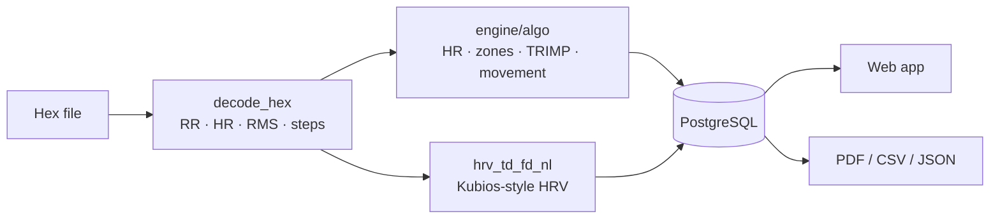

<div align="center">

# NetriBeat

**Heart-rate, HRV, training-load and movement analysis for Synapse sensor recordings.**

Upload a sensor hex file → get heart rate, zones, training load, movement load, Kubios-style HRV
and a two-page PDF report.

`Python 3.12 · FastAPI · PostgreSQL · Redis` &nbsp;|&nbsp; `React 19 · Vite` &nbsp;|&nbsp; `Render · Neon · Vercel · Brevo`

</div>

---

## Features

| Area | What you get |
|---|---|
| **Accounts** | Registration with an emailed code, user and admin sign-in, "keep me signed in", device list, forgot / reset password, admin user management, audit log |
| **Upload** | Synapse hex files (`.txt`), up to 10 at a time; optional age, gender, resting HR, height, weight and max HR per upload |
| **Analysis** | Hex decoding, smoothed HR, min / avg / max HR, HR zones, Banister TRIMP training load, movement load, steps, respiratory rate |
| **HRV** | Time domain, Welch FFT / AR / Lomb–Scargle spectra, Poincaré, entropy, DFA, recurrence, autonomic balance, re-run with your own options |
| **Reports** | Two-page branded PDF, JSON export, CSV exports (metrics, HR, beats, movement) |

## How it works



## Quick start

```powershell
# 1. Database and Redis
cd infra;    copy .env.example .env;   docker compose up -d
# 2. Backend  → http://127.0.0.1:8000/api/docs
cd ..\backend;  copy .env.example .env;  uv sync
uv run uvicorn --factory netribeat.main:app_factory --reload
# 3. Frontend → http://localhost:5173
cd ..\frontend;  npm install;  npm run dev
```

Full steps, including creating your first admin: **[Getting started](docs/getting-started.md)**.

## Project layout

```
backend/     FastAPI app (auth, email, sessions, reports)      → docs/architecture.md
frontend/    React app (pages, charts, API client)             → docs/architecture.md
infra/       Docker images, Compose files, Caddy               → docs/deployment.md
docs/        Documentation (start below)
```

## Documentation

| Guide | Read it to… |
|---|---|
| [Getting started](docs/getting-started.md) | Run NetriBeat on your computer |
| [Architecture](docs/architecture.md) | Understand the system and what every file does |
| [Authentication & email](docs/authentication.md) | Follow every sign-in flow and the security rules |
| [Processing & algorithms](docs/processing.md) | See how a hex file becomes metrics, formula by formula |
| [Reports & exports](docs/reports.md) | Know what the PDF, JSON and CSV files contain |
| [API reference](docs/api.md) | Call the backend directly |
| [Configuration](docs/configuration.md) | Set environment variables |
| [Deployment](docs/deployment.md) | Put it online (Render + Neon + Vercel + Brevo) |

> **Note** — results are research estimates, not a clinical diagnosis.
