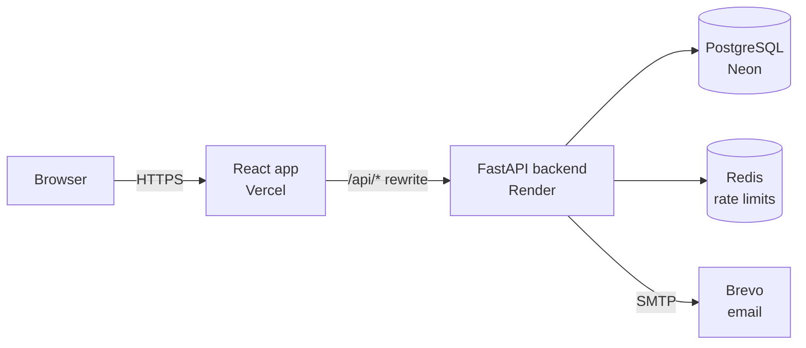
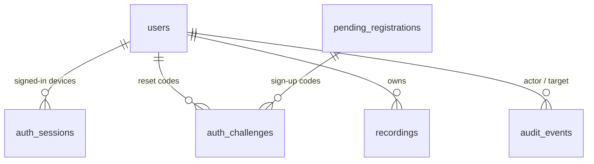

# Architecture

How the pieces fit together, and what every file is for.

[← Back to README](../README.md)

---

## System



- **One origin.** Vercel forwards `/api/*` to the backend, so the browser talks to a single site
  and the `HttpOnly` sign-in cookie works.
- **Stateless backend.** Everything lives in PostgreSQL, including uploaded files. Redis holds
  only short-lived rate-limit counters.
- **Synchronous analysis.** A hex file is decoded and analysed during the upload request
  (about a second), so no background worker is needed.

## Request lifecycle

```
request → AccessLog → CORS → SecurityHeaders → BodyLimit → router → service → repository → DB
                                                              │
                                     errors raised as AppError → one JSON shape: {code, message, fields}
```

Routers only parse input and return schemas. Business rules live in services. SQL lives in
repositories (or the service, for the small sessions feature).

## Backend — `backend/src/netribeat/`

### Top level

| File | Purpose |
|---|---|
| `main.py` | Builds the app: middleware, error handlers, routers, start-up (DB tables, Redis) |
| `config.py` | Every setting, read from environment variables; refuses unsafe production values |
| `db.py` | Async SQLAlchemy engine, `Base`, per-request session, `init_db()` (creates/updates tables) |
| `clock.py` | Injectable clock, so time can be frozen in tests |
| `cli.py` | `netribeat` command: create admins/users, change roles, disable, cleanup |

### `core/` — shared plumbing

| File | Purpose |
|---|---|
| `api_model.py` | Base schema: camelCase JSON ↔ snake_case Python; shared error responses |
| `errors.py` | `AppError` family (400 / 401 / 403 / 404 / 409 / 413 / 429 / 503) |
| `middleware.py` | Security headers, request-size limit, access log without query strings |
| `ratelimit.py` | Fixed-window counters in Redis |
| `logging_config.py` | `key=value` logs with a filter that redacts anything secret-looking |

### `auth/` — accounts, sign-in, users, admin

| File | Purpose |
|---|---|
| `models.py` | Tables: `users`, `pending_registrations`, `auth_challenges`, `auth_sessions`, `audit_events` |
| `schemas.py` | Request/response shapes for `/auth`, `/users/me`, `/admin` |
| `security.py` | Argon2id hashing, JWT access tokens, OTP codes, HMAC token hashes |
| `password_policy.py` + `common_passwords.txt` | Length, blocklist, no name/email, optional breach check |
| `service.py` | Register, verify, login, refresh, logout, forgot/reset password, device sessions |
| `repository.py` | SQL for sign-ups, challenges and device sessions |
| `user_service.py` / `user_repository.py` | Profile updates and admin user management |
| `audit.py` | Writes and lists security events (ids only, never emails or secrets) |
| `deps.py` | FastAPI dependencies: current user, admin check, CSRF check, injected services |
| `router.py` | `/api/v1/auth/*` |
| `user_router.py` | `/api/v1/users/me/*` |
| `admin_router.py` | `/api/v1/admin/*` |

Details: [Authentication & email](authentication.md).

### `email/` — outgoing mail

| File | Purpose |
|---|---|
| `service.py` | Senders: `console` (dev), `file` (dev), `smtp` (real), `memory` (tests); template rendering |
| `validation.py` | Email normalising (`strip().lower()`) and syntax check |
| `templates/*.txt` | `verify_email`, `account_activated`, `account_exists`, `account_invited`, `password_reset_code`, `password_reset_done` |

### Analysis — one folder per stage

```
hex_decoder/       decode_hex.py   Synapse hex → RR, HR, RMS, steps per session (reference, unchanged)
                   reader.py       read an upload: decode, athlete name from the file name, errors
rr_interval/       rr_intervals.py beat times and RR intervals of one session
preprocessing/     artefact_correction.py  artefact detection + correction (spec 20 % rule, Kubios levels)
                   detrending.py           smoothness-priors detrending, 4 Hz resampling
engine/algo/
  common.py                          3 s buckets, exponential smoothing, durations, rounding
  hr/heart_rate.py                   smoothed 3 s HR series
  max_min_avg_hr/hr_statistics.py    session min / avg / max HR
  training_load/training_load.py     zones, time in zone, Banister TRIMP, intensity
  movement_load/movement_load.py     RMS series, movement load and intensity
  hrv_td_fd_nl/time_domain.py        every time-domain statistic (spec + Kubios + over time)
  hrv_td_fd_nl/frequency_domain.py   every spectrum: Lomb–Scargle, Welch FFT, AR; band powers
  hrv_td_fd_nl/nonlinear.py          Poincaré, ApEn, SampEn, DFA, recurrence
  respiration_rate/respiration_rate.py  breaths per minute from the HF peak
metrics/           derived_metrics.py  HR + training load + movement load for a session (reference)
                   hrv_metrics.py      Kubios-style HRV report: sample, correction, TD/FD/NL, ANS
                   session_metrics.py  the full output stored per session (metrics + signals)
sessions.py        the /api/v1/sessions API in one file: table, schemas, rules, routes
```

Flow: `hex_decoder → rr_interval → preprocessing → engine/algo → metrics → sessions.py (database + API)`.
The reference engine code (decoder, heart rate, zones, training and movement load) keeps its
original function code; only its location and imports changed.

Details: [Processing & algorithms](processing.md).

### `reports/` and `health/`

| File | Purpose |
|---|---|
| `reports/pdf.py` | Two-page PDF (matplotlib) |
| `reports/exports.py` | JSON and CSV exports |
| `health/router.py` | `/health` (process up) and `/health/ready` (database + Redis) |

## Data model



| Table | One row per |
|---|---|
| `users` | Person: email, name, role (`user`/`admin`), password hash, optional profile fields (never used by the analysis) |
| `pending_registrations` | Sign-up waiting for its email code (never a usable account) |
| `auth_challenges` | One-time code (stored as an HMAC), for sign-up or password reset |
| `auth_sessions` | Signed-in device: hashed refresh token, expiry, user agent, IP |
| `audit_events` | Security event (login, role change, upload, delete …) |
| `recordings` | Analysed session: the hex file, subject details, summary numbers, full `metrics` and `signals` |

Tables are created on start-up by `init_db()`; new columns are added there with
`ADD COLUMN IF NOT EXISTS`.

## Frontend — `frontend/src/`

```
main.jsx · app.jsx        entry point (light theme) and routes with sign-in / admin guards
api/client.js             every API call; access token in memory, one refresh on 401, upload, downloads
auth/AuthContext.jsx      current user; restores the sign-in on page load
components/               DashboardLayout (sidebar), ui (buttons, fields, alerts), badges, Modal
charts/                   dependency-free SVG charts; LineChart has zoom, pan and an overview strip
pages/
  DashboardPage.jsx       latest session and trends
  auth/                   Login, Register, VerifyEmail, ForgotPassword, ResetOtp, NewPassword
  sessions/               SessionsPage, SessionPage (+ AdvancedHrv tab), UploadPage
  settings/               SettingsPage = ProfileSection + SecuritySection (password, devices)
  admin/                  UsersPage, AuditPage
utils/                    format.js, session.js (labels, zone colours), validation.js (email, password)
styles/                   tokens.css (black / orange, light theme), app.css
__tests__/                Vitest + Testing Library
```

| Route | Page | Who |
|---|---|---|
| `/login`, `/admin/login`, `/register`, `/verify-email` | `pages/auth/*` | Public |
| `/forgot-password`, `/reset/verify`, `/reset/new` | `pages/auth/*` | Public |
| `/` | `DashboardPage` | Signed in |
| `/sessions`, `/sessions/:id`, `/upload` | `pages/sessions/*` | Signed in |
| `/settings` (`/account`, `/security` redirect here) | `pages/settings/SettingsPage` | Signed in |
| `/admin`, `/admin/audit` | `pages/admin/*` | Admin |

## Infrastructure — `infra/`

| File | Purpose |
|---|---|
| `docker-compose.yml` | Local PostgreSQL + Redis |
| `Dockerfile.backend` | Backend image (used by Render) |
| `Dockerfile.web` | Frontend built and served by Caddy (self-hosted option) |
| `docker-compose.prod.yml` + `Caddyfile` | Whole stack on one server with automatic HTTPS (self-hosted option) |
| `.env.example`, `.env.production.example` | Templates for the Compose files |
