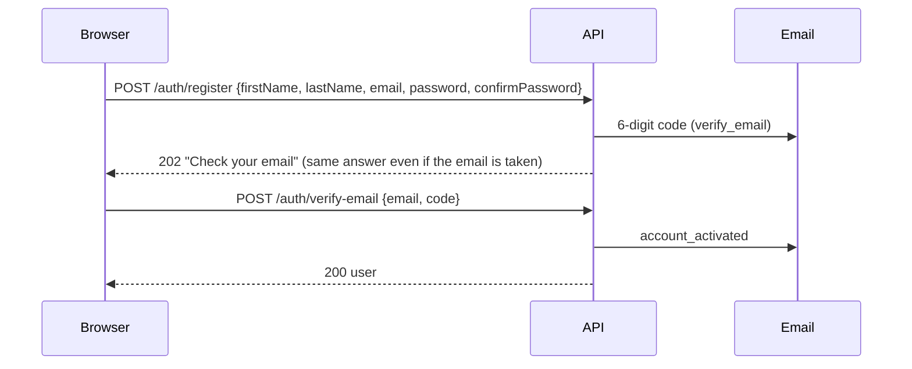

# Authentication & email

Every sign-in flow, the tokens behind it, and the security rules. Code: `backend/src/netribeat/auth/`
and `backend/src/netribeat/email/`.

[← Back to README](../README.md)

---

## Roles

| Role | Can |
|---|---|
| `user` | See and upload only their own sessions; edit own profile, password and devices |
| `admin` | Everything a user can, for **all** users; manage users and roles; read the audit log |

Admins are created **only** with the CLI (`netribeat create-admin`), or promoted by another admin.
Public registration can only ever create a `user`.

## Tokens

| Token | Lives in | Lifetime | Notes |
|---|---|---|---|
| **Access token** (JWT, HS256) | Browser memory only | 15 min | Sent as `Authorization: Bearer …`; holds the user id, session id and a token version — **never the role** |
| **Refresh token** (random) | Cookie `nb_refresh` — `HttpOnly`, `Secure`, `SameSite=Strict`, path `/api/v1/auth` | 12 h, or 30 days with *Keep me signed in* | Stored only as a hash; replaced on every use |

On every request the backend loads the device session and the user, so signing out, disabling
an account or changing a role takes effect **immediately**, even for a still-valid access token.

## Flows

### Register → verify



- The sign-up waits in `pending_registrations` and is **not** an account until the code is correct.
- If the email already has an account, the person gets an `account_exists` email instead, and the
  response is identical — nobody can probe which emails are registered.
- Codes: 6 digits, valid 10 min, 5 attempts. New code via `/auth/resend-verification`
  (60 s cooldown, max 3 emails per address per hour).

### Sign in → stay signed in → sign out

| Step | Endpoint | Result |
|---|---|---|
| Sign in | `POST /auth/login {email, password, remember, mode}` | Access token + refresh cookie. `mode: "admin"` is refused (same 401) for non-admins |
| Page load / token expired | `POST /auth/refresh` | New access token; cookie rotated. Re-using an old cookie revokes that device |
| Sign out | `POST /auth/logout` | Device session revoked, cookie cleared |

Every login failure — unknown email, wrong password, disabled account, no password yet — returns
the **same** `401 invalid_credentials`.

### Forgot password

```
POST /auth/forgot-password {email}         → 202 (same answer whether or not the account exists)
POST /auth/verify-reset-otp {email, code}  → 200 {resetToken}   (single use, 10 min)
POST /auth/reset-password {resetToken, password, confirmPassword} → 204, every device signed out
```

Accounts created by an admin have no password; the person sets one through this flow.

### Signed-in account management

| Endpoint | Does |
|---|---|
| `PATCH /users/me` | Your first and last name (shown on the Settings page) |
| `POST /users/me/password` | Needs the current password; signs out other devices |
| `GET /users/me/sessions` | My signed-in devices |
| `DELETE /users/me/sessions/{id}` · `POST /users/me/sessions/revoke-others` | Sign devices out |

### Admin

| Endpoint | Does |
|---|---|
| `GET /admin/users` · `GET /admin/users/{id}` | List, search, view |
| `POST /admin/users` | Create a user without a password (optional `account_invited` email) |
| `PATCH /admin/users/{id}/status` · `/role` | Disable / enable, change role — signs the user out everywhere |
| `POST /admin/users/{id}/sessions/revoke-all` | Sign a user out everywhere |
| `GET /admin/audit-events` | Security log |

The last active admin can't be demoted or disabled.

## Password rules

- Length 12–128 (minimum configurable, never below 8).
- Not in the built-in common-password list; must not contain the email or name.
- Optional breach check against Have I Been Pwned (k-anonymity — only 5 hash characters leave
  the server): `HIBP_CHECK_ENABLED=true`.
- Hashed with **Argon2id**; old hashes are upgraded on the next sign-in.

## Security controls

| Threat | Control |
|---|---|
| Guessing passwords | 10 failures per email and 30 per IP in 15 min (Redis); fails closed (503) if Redis is down |
| Guessing codes | 5 attempts per code, 30 checks per IP in 15 min, codes expire |
| Database leak | Passwords Argon2id; codes and tokens stored only as HMAC-SHA256 with a server pepper |
| CSRF | `SameSite=Strict` cookie + required `X-Requested-With: NetriBeat` header + Origin allow-list |
| XSS stealing tokens | Access token only in memory; refresh cookie unreadable by JavaScript; strict CSP |
| Account enumeration | Identical answers for register, resend and forgot-password; identical login failures |
| Self-promotion | `role` in registration accepts only `"user"`; unknown fields are rejected |
| Oversized requests | 64 KB JSON limit; uploads 20 MB per file, 10 files |
| Secrets in logs | No query strings logged; a filter redacts password / token / code / email keys |
| Unsafe production config | Start-up refuses short or equal secrets, insecure cookies, `*` CORS, non-HTTPS frontend, non-SMTP mail |

## Email

| Template | Sent when |
|---|---|
| `verify_email` | Registration / resend |
| `account_activated` | Code accepted |
| `account_exists` | Someone registers with an email that already has an account |
| `password_reset_code` | Forgot password |
| `password_reset_done` | Password changed or reset |
| `account_invited` | An admin creates an account |

Templates are plain text in `email/templates/`; the first line is `Subject: …`. Mail is sent in the
background after the response, so timing doesn't reveal anything. Emails never contain a password.

| `EMAIL_BACKEND` | Behaviour |
|---|---|
| `console` | Prints the message (with the code) in the backend window — development |
| `file` | Writes `.eml` files to `EMAIL_FILE_DIR` — development |
| `smtp` | Real delivery (Brevo in production) — required when `ENVIRONMENT=production` |
