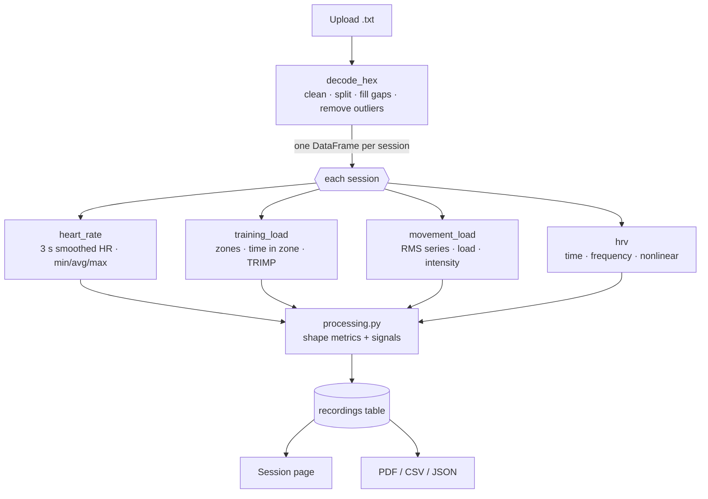

# Processing & algorithms

How a Synapse hex file becomes heart rate, zones, training load, movement load and HRV.
Code: `backend/src/netribeat/sessions/`.

[← Back to README](../README.md)

---

## Pipeline



| Stage | File | Origin |
|---|---|---|
| Decode | `engine/decode_hex.py` | Reference code (SES-4), **unchanged** |
| Heart rate, zones, TRIMP, movement | `engine/derived_metrics/*`, `engine/analyse.py` | Reference code (SES-7), **unchanged** |
| HRV | `hrv/advanced.py`, `hrv/spectral.py`, `hrv/artefacts.py` | Kubios-compatible definitions |
| Glue | `processing.py`, `service.py` | Chooses inputs, renames fields, stores results |

Analysis runs inside the upload request; a 30-minute file takes about a second.

## 1 · The hex file

The sensor detects beats itself — there is **no raw ECG**. It stores RR intervals,
accelerometer RMS and step counts.

**File name** `NAME_YYYY-MM-DD_HH_MM_SS.txt` = athlete name and recording start in IST. Without it, the
*Recorded on* field or the upload time is used.

**One packet per line, 200 hex characters, 7.5 s each:**

| Characters | Field |
|---|---|
| 0 | Type: `0` data · `1` restart · `2`/`3` start · `4`/`5` stop · `6` resume |
| 1 | Battery 0–10 (× 10 %), on identifier packets |
| 2–9 | Sensor clock, seconds |
| 10–11 | Steps in the packet |
| 12–19 | `FFFFFFFF` |
| 20–199 | 30 samples × 6 chars, one per 250 ms |

Each sample `R M R R M M` packs two 12-bit values: **RR** in ms (0 = no beat in that slot) and
**RMS**. `FFF` (4095) = no value.

## 2 · Decoding — `decode_hex.py`

1. **Clean** — drop invalid lines; of two neighbouring identifier packets of the same type keep the
   second; after a mid-file restart drop what follows if ≤ 16 packets; drop duplicates; drop
   identifier packets that carry samples.
2. **Split into sessions** — from each start packet to its stop packet, adding missing starts/stops.
   Sessions without data are ignored. **Each session becomes its own row** in NetriBeat.
3. **Per session**
   - keep data packets only, sorted by time;
   - fill gaps over 8.5 s with empty packets (`(gap − 1) // 7.5` of them; one for gaps > ~30 min);
   - remove RR outliers: RR = 4095, or > 1.9× / < 0.57× the median of the next 12 RR values;
   - skip sessions with ≤ 24 RR values;
   - place beats in time from the slot RR values; a lost beat leaves a break.

**Output** — one long table per session: `timestamp, data_item, value`.

| `data_item` | One row per | `value` |
|---|---|---|
| `rrt` | beat | RR to the next beat (ms); empty at a break |
| `hr` | 250 ms slot | 60000 / RR (bpm) |
| `rms` | 250 ms slot | accelerometer RMS |
| `steps` | 7.5 s packet | steps |

## 3 · Heart rate — `derived_metrics/heart_rate.py`

```
HR per beat → capped-step smoothing → median per 3 s → exponential smoothing (decay 0.7)
            → values outside 28–230 bpm removed
```

- **Capped-step smoothing** starts at the median of the first 10 beats and moves toward each new
  value by 0/1/2/3 bpm depending on the distance (only 1 bpm for jumps ≥ 30), so single bad beats
  can't spike the curve.
- **Exponential smoothing:** `y = previous × 0.7 + x × 0.3`.

| Metric | Definition |
|---|---|
| Max HR | Highest value in a stable stretch: 3 values in a row within 5 bpm |
| Min HR | 1st percentile |
| Avg HR | Mean of the plausible values |

## 4 · Zones & training load — `derived_metrics/training_load.py`

**Inputs, per upload.** One account tests many athletes, so the **account profile is never used**:
each value comes from the upload form (the name also from the file name), otherwise it is "—".

| Input | Used for | Default |
|---|---|---|
| Max HR | Zones, TRIMP | *Max HR override* on upload → **210 − 0.65 × age** |
| Resting HR | TRIMP | 50 bpm |
| Gender | TRIMP factor | — (training load needs male or female) |
| Age | Max HR formula | — |
| Athlete name | Report header box | Upload field → file name → — |

**Zones** (% of max HR): below Z1 < 50 · Z1 50–60 · Z2 60–70 · Z3 70–80 · Z4 80–90 · Z5 ≥ 90.
Time in zone sums each 3 s bucket's duration.

**Training load — Banister TRIMP:**

```
r     = (HR − resting) / (max − resting)
TRIMP = Σ minutes × r × 0.64 × e^(k·r)        k = 1.92 men, 1.67 women
```

HR below resting adds nothing. **Training intensity** = TRIMP per minute of recording.

## 5 · Movement load — `derived_metrics/movement_load.py`

```
RMS per 250 ms → exponential smoothing (decay 0.9) → mean per 3 s → gaps filled from neighbours
movement load      = Σ RMS × seconds / 3600          (RMS-hours)
movement intensity = load per hour of recording
```

**Steps** = sum of the per-packet step counts.

## 6 · HRV — `hrv/`

HRV uses the beats from the decoder (`rrt`), with each RR placed at the end of its interval.

### Artefact correction

| Where | Rule |
|---|---|
| Overview and spec tables (`artefacts.py`) | Beat > 20 % from the median of its 11-beat window, or outside 250–2500 ms → replaced by that median |
| Kubios-style analysis (`advanced.py`) | Threshold levels very low / **low** (default) / medium / strong / very strong = 0.45 / 0.35 / 0.25 / 0.15 / 0.05 s at 60 bpm, scaled by mean RR; replaced by cubic-spline interpolation |

### Spec HRV (session page overview) — `spectral.py`

First 5 minutes of the corrected series:

| Metric | Formula |
|---|---|
| Mean RR, Mean HR | mean(RR), mean(60000 / RR) |
| SDNN | sample SD of RR |
| RMSSD | √mean(ΔRR²) |
| pNNI20 / pNNI50 | % of \|ΔRR\| > 20 / 50 ms |
| Frequency domain | Lomb–Scargle, 0.002–0.5 Hz; VLF 0.0033–0.04, LF 0.04–0.15, HF 0.15–0.4 Hz |
| Poincaré | SD1, SD2 |
| Respiratory rate | HF peak (Hz) × 60; per minute from 2-min windows stepped 1 min |

### Kubios-style HRV — `advanced.py`

Default sample: first 5 min (changeable on the *HRV analysis* tab). The sample is detrended with
**smoothness priors** (λ = 500).

| Group | Metrics |
|---|---|
| Time domain | Mean RR, SDNN, Mean HR, SD HR, Min/Max HR (5-beat average), RMSSD, NN50, pNN50, RR triangular index, TINN, Stress index (√ Baevsky SI) |
| Frequency domain | **Welch FFT** (256 s window, 50 % overlap) and **AR** (order 16) on RR resampled at 4 Hz; Lomb–Scargle; per band: peak Hz, power ms², ln power, %, n.u.; total; LF/HF |
| Nonlinear | Poincaré SD1, SD2, SD2/SD1; ApEn and SampEn (m = 2, r = 0.2 × SDNN); DFA α1 (4–16 beats) and α2 (16–64); recurrence REC, DET, Lmean, Lmax, ShanEn |
| Autonomic balance | PNS components (Mean RR, RMSSD, SD1 %) and SNS components (Mean HR, Stress index, SD2 %) |
| Over time | RMSSD, SDNN, SD1, mean HR and stress index in 60 s windows, every 10 s |

Definitions follow Kubios: n.u. = band / (LF + HF) × 100; mean RR/HR and min/max HR use the
non-detrended series, everything else the detrended one. ApEn, SampEn and recurrence are skipped
above 4000 beats. Kubios' PNS/SNS **index** values need its population norms, so only their
components are reported.

## 7 · What gets stored

`processing.py` writes two JSON documents per session (`recordings.metrics`, `recordings.signals`)
plus summary columns for lists.

| `metrics` key | Content |
|---|---|
| `hr`, `hrMax`, `timeInZonesS`, `zonesUnavailableReason` | Heart rate and zones |
| `trainingLoad`, `trainingIntensity`, `movementLoad`, `movementIntensity`, `steps` | Loads |
| `subject` | Age, gender, resting HR, height, weight, max HR actually used |
| `timeDomain`, `frequencyDomain`, `poincare`, `respiratoryRate` | Spec HRV |
| `advanced` | Kubios-style HRV and its options |
| `engine` | The engine's own output, untouched |
| `beats`, `reliability`, `unavailable`, `analysisVersion` | Bookkeeping |

| `signals` key | Content |
|---|---|
| `hr` | Smoothed HR (`tS`, `bpm`) |
| `beatTimesS`, `rrRawMs`, `rrCorrectedMs`, `artefactIndices` | Beats |
| `rms`, `steps` | Movement series |
| `perMinute.respiratoryRate` | Respiration per minute |
| `advanced` | Tachogram, sample, histogram, spectra, DFA points, time-varying HRV |

## Re-analysis

| Trigger | What re-runs |
|---|---|
| *Retry analysis* on a session | Whole pipeline from the stored file |
| *Apply* on the HRV analysis tab | Kubios-style HRV only, with the chosen options |

## Limits

- Results are research estimates, not a clinical diagnosis.
- Training load needs gender male/female; zones need age or a max HR.
- Only Synapse hex files are accepted.
